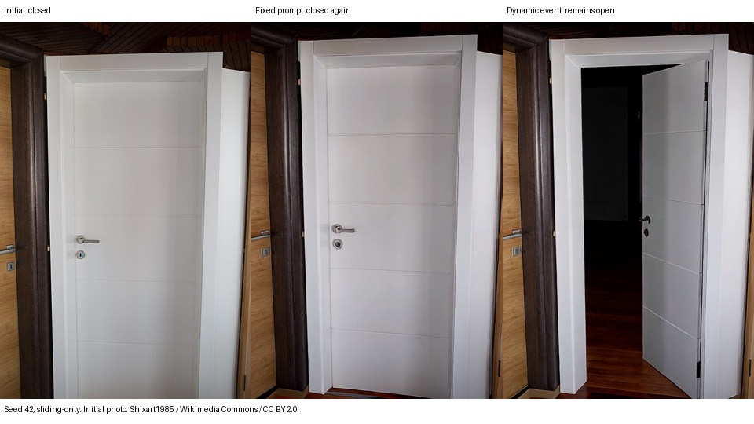

# 开门语义闭环：视觉复核结论

本轮已实际运行 Qwen3-VL-8B → 语义事件 → LingBot 生成 → 新画面观察 → 修正事件。两种策略共用初始图、seed 和第一条开门提示词，所有六对试验第一段像素哈希一致，随后动态组的提示词与输出开始分化。共12条视频、192个生成段。

**观察到有条件的视觉改善，但还不是可靠的通用开门能力。**

| 配置 | 固定提示词 | VLM 动态事件 |
|---|---|---|
| 原扩展记忆配置 | 3个seed均有末段回关、窄缝或几何问题 | 同样未看到清楚、稳定且几何可信的末段成功 |
| 仅滑窗与sink | seed42回关；123几何异常；2026收窄为半开 | seed42、2026末段清楚打开；123仍有几何异常 |

这里的复核是本助手检查末两段的首/中/末共六张图，不是独立人工盲标或逐帧全视频评测。seed42在倒数第二段由关闭/窄缝转为打开，最后一段三个样本均保持打开；seed2026最后两段的六个样本均有明显通道和靠右的门扇。因此“末段保持打开”只覆盖约一秒左右的已观察区间，不能外推到长时间保持。

## 自动评估必须保留为辅助证据

原始自动评估见 [REPORT.md](REPORT.md)。它给第二轮动态组2/3，但通过的是seed42和123。

截图显示seed123存在白色门框/门扇结构一起转动的问题，不宜计为几何可信的成功；seed2026却在明显打开时被判为ajar。虽然粗略计数恰好同为2/3，具体样本并不相同。因此不能把自动2/3直接作为真实成功率，也不能用Director自报open判定任务完成。

## 对照画面

- [seed42 对照视频](sliding-only/comparison-42.mp4)
- [seed2026 对照视频](sliding-only/comparison-2026.mp4)
- [seed123 几何问题对照](sliding-only/comparison-123.mp4)
- [动态组seed42末段六帧](sliding-only/42-dynamic/tail.jpg)
- [动态组seed2026末段六帧](sliding-only/2026-dynamic/tail.jpg)
- [动态组seed123末段六帧](sliding-only/123-dynamic/tail.jpg)

## 能得出的结论

1. 语义条件确实驱动了实际开门画面，视觉反馈也确实改变后续生成，不只是回执和文字变化。
2. 这组样本中，动态事件配合较简单的记忆配置出现了比固定提示词更好的末段结果。
3. 一次同时移除了扩展检索、world pruning和PC压缩，不能归因于其中某一项；也不能证明旧记忆冲突就是唯一原因。
4. 仍需解决对象几何约束和可信状态检测；当前同一VLM作Director和评估器会产生误判。动态策略还增加了约2.6秒/段的VLM推理开销。
5. 单一真实门图、3个seed、每条约11.8秒、一次事后记忆消融，未覆盖新场景、独立留出任务或分钟级稳定性。

初始图为 [Shixart1985 的 Closed white door.jpg](https://commons.wikimedia.org/wiki/File:Closed_white_door.jpg)，[CC BY 2.0](https://creativecommons.org/licenses/by/2.0/)，使用缩略图并缩放。后续画面为模型生成。

本文件和 visual-result-42.jpg 是下载并校验 evidence.tar.gz 后新增的视觉复核产物；原包的96个文件均已通过SHA256校验，原始评估和失败记录未改写。
