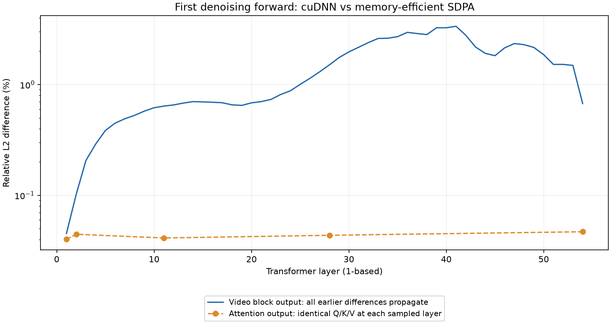

# Hy-Nomas attention numerical diagnosis, 2026-10-26

The first divergence is inside the first joint-attention operation, with
identical Q/K/V, mask and initial noise. The inspected cuDNN adapter agrees
bitwise with direct PyTorch cuDNN SDPA. The baseline agrees bitwise with direct
memory-efficient SDPA. Repeated execution and masked-key corruption checks pass
for both backends on five captured real-weight layers.

Small backend differences propagate through the BF16 transformer: replacing
only the first of 54 attention layers already changes the first denoising
prediction by 0.6924% relative L2. Replacing all layers gives 0.7638%.
This supports numerical sensitivity as the immediate explanation for the
rollout mismatch. It does not identify a specific internal cuDNN instruction,
prove perceptual degradation, or qualify cuDNN for the default deployment.
Production sources and backend selection are unchanged.

## Why cuDNN was tested

The existing `CUDNN_ATTN` backend shares the attention dispatcher used by the
integration and accepts the current Boolean padding mask. It requires no
model-specific attention kernel. On this GPU, the previous actual-shape random
probe measured 55.820 to 19.171 ms for Q/K=27,680 and 112.652 to 38.799 ms for
K=55,360. The tested PyTorch Flash SDPA path rejected the non-null mask.
Those results establish a performance candidate, not full-model accuracy or a
universal comparison with other FlashAttention implementations.
See [the optimization report](hy_nomas_optimization.md).

## Frozen scope and method

- Repository head: `62181381234b4aaea55207dd08b3862bd0926753`. Model pipeline,
  transformer, SDPA backend and cuDNN backend hashes match the remote snapshot.
- Same released checkpoint, GPU and runtime as the optimization report:
  RTX PRO 6000 Blackwell Server Edition, PyTorch 2.13.0+cu130, cuDNN version
  reported by PyTorch as `92000`, vLLM 0.32.0 CI wheel. No package changes.
- Same fox/forest prompt, seed 42, CPU noise generator, 1280 x 704, 240 frames,
  eight configured steps, CFG=1 and BF16. Diagnose only the first denoising
  forward of segment 0; no camera, action groups or historical KV in this call.
- External hooks return the original result during baseline capture. That
  complete first prediction reproduces the previously saved baseline bitwise.
- During the baseline trajectory, evaluate both attention backends on identical
  live inputs at each of 54 layers. Save full Q/K/V and mask for zero-based
  layers 0, 1, 10, 27 and 53. No token is removed or reordered.
- Run a second aligned first forward with only joint attention using the shared
  cuDNN adapter. Text refinement and all other operations retain the baseline.
- For captured-layer references, sample 48 video queries spread across the
  sequence plus all 25 valid text queries. Retain all 27,680 K/V positions and
  the original mask; 26,425 keys are valid. Evaluate explicit FP64
  `softmax(QK^T / sqrt(128)) V` on all 16 heads. FP32/FP64 sanity checks use
  eight additional recorded query positions; TF32 is disabled.

The original eight-row checks include one padded text query; the expanded
73-row comparison below uses only valid queries. Full-video comparisons use
all 26,400 video queries. Relative L2 means `norm(candidate-reference) /
norm(reference)`; metric reductions are FP32. Full-prediction metrics below
are computed on CPU to match the earlier accuracy harness.

## First divergence and adapter checks

Both aligned runs have initial latent SHA-256
`95b99eccea2e8952108c996e1cca3506fe67d0c2e775e4bd36682b55831006ac`.
First-layer Q/K/V/mask hashes are identical. Captured tensors have
`[1,27680,16,128]` BSHD layout and the mask has `[1,1,1,27680]` shape.
Scale is `128**-0.5`, dropout is zero, attention is noncausal and Q/KV both
have 16 heads. This path does not use GQA, prefix slicing or piecewise spans.

At all five captured layers:

- Shared cuDNN adapter equals directly forced PyTorch cuDNN SDPA bitwise.
- Baseline adapter equals directly forced memory-efficient SDPA bitwise.
- Repeating each backend on identical full inputs gives identical output.
- Setting every invisible key to 31 and invisible value to 1000 leaves output
  bitwise unchanged. This tests mask exclusion without changing sequence shape.
- Boolean mask and equivalent BF16 zero/negative-infinity additive mask give
  bitwise identical output for each backend.

This rules out the tested adapter/layout/mask conversions and observed
within-process repeatability as the source. It is not a qualification of every
mask shape, backend algorithm or execution environment.

## Comparison with higher-precision attention

The table reports relative L2 error against the explicit FP64 reference on
73 valid queries per captured layer, with complete K/V. Layer numbers are
one-based here; artifact indices are zero-based.

| Layer | Memory-efficient BF16 error | cuDNN BF16 error |
| --- | ---: | ---: |
| 1 | 0.1706103% | 0.1706101% |
| 2 | 0.1722730% | 0.1722728% |
| 11 | 0.1711953% | 0.1711347% |
| 28 | 0.1723022% | 0.1722619% |
| 54 | 0.1682224% | 0.1680130% |

The errors are essentially the same scale; cuDNN is marginally closer in these
samples. This does not establish a practically significant accuracy advantage.
It does contradict interpreting the baseline mismatch alone as evidence that
cuDNN is substantially less accurate at the attention operation.

As an additional diagnostic, converting captured inputs to FP16 and retaining
FP16 attention output gives approximately 0.021-0.024% error against the same
FP64 reference. Casting that output back to BF16 loses that advantage. This is
not an FP16 model qualification: BF16-to-FP16 input conversion, output rounding
and internal arithmetic all change. A simple BF16-probability reference does
not reproduce either fused backend bitwise, so it does not isolate their
specific internal reduction or rounding sequence.

PyTorch documents that fused SDPA backends can produce different outputs due
to floating-point operations. This is consistent with the measurements, but
is not a substitute for them or a guarantee of downstream quality.
See [PyTorch SDPA documentation](https://docs.pytorch.org/docs/stable/generated/torch.nn.functional.scaled_dot_product_attention).

## Propagation and controlled single-layer replacement

On identical inputs, cuDNN versus memory-efficient attention differs by
0.040-0.047% relative L2 over video queries in the five sampled layers.
At layer 1, 1.06% of output values differ; the maximum absolute difference over
video queries is 0.0078125. Padded text rows are excluded from these figures.

In the full cuDNN trajectory, preceding differences change later Q/K/V, so the
block-output comparison measures propagated differences rather than isolated
attention error:

| Layer | Video block-output relative L2 difference |
| --- | ---: |
| 1 | 0.04526% |
| 2 | 0.10206% |
| 11 | 0.63888% |
| 28 | 1.50668% |
| 54 | 0.67366% |



Growth is not monotonic, and the final projection changes the metric again.
The following intervention keeps every other attention layer on the baseline:

| First-forward configuration | Prediction relative L2 vs baseline | Maximum absolute difference |
| --- | ---: | ---: |
| Instrumented baseline | 0% (bitwise exact) | 0 |
| Only layer 1 uses cuDNN | 0.69240% | 0.078125 |
| Only layer 54 uses cuDNN | 0.12306% | 0.03125 |
| All 54 joint-attention layers use cuDNN | 0.76379% | 0.0859375 |

A single early-layer change is therefore sufficient to create most of the
observed first-prediction discrepancy in magnitude. These differences are not
additive, and this experiment does not assign a percentage of causal
responsibility to each layer. The prior full rollout then showed growing
prediction/latent/RGB differences across denoising steps; it is not rerun here.

## Consequences and remaining questions

There is no demonstrated adapter bug to fix in this path. The baseline remains
TORCH_SDPA because the faster path has not satisfied the existing output-parity
contract. Requiring bitwise equality to one BF16 backend is different from
requiring agreement with an independent numerical or native-model reference.
Neither the attention sample nor this first-forward diagnosis establishes a
new acceptable image/video threshold.

A follow-up should compare the complete rollout to an aligned native reference
and evaluate image, temporal and interaction quality under an explicitly
selected tolerance. Higher precision in selected sensitive operations can be
investigated, but the single-layer result shows that replacing only a few layers
is not automatically a safe workaround. Historical-KV/action masks and later
denoising states remain outside the captured-input checks in this report.

## Reproduction and evidence

Scripts are external diagnostic tools, not repository model-specific examples.
From the archived evidence, restore `diagnose.py` to the absolute path used by
`interventions.py`, then run in the frozen remote code environment:

```bash
cd /root/autodl-tmp/nomas-opt/work
export PYTHONPATH=.:/root/autodl-tmp/hy-nomas-test-deps
export OMP_NUM_THREADS=1
export HF_HUB_OFFLINE=1
cp /root/autodl-tmp/nomas-attn-diagnosis/diagnose.py \
  /root/autodl-tmp/diagnose-nomas-attention.py
/root/autodl-tmp/venv-nomas-review/bin/python \
  /root/autodl-tmp/diagnose-nomas-attention.py
/root/autodl-tmp/venv-nomas-review/bin/python \
  /root/autodl-tmp/nomas-attn-diagnosis/probe_captured.py
/root/autodl-tmp/venv-nomas-review/bin/python \
  /root/autodl-tmp/nomas-attn-diagnosis/interventions.py
```

The diagnosis consumes the preceding baseline's `baseline-main.pt` for exact
reproduction. It creates its own captured tensors and first-prediction outputs
for the subsequent probes. These are diagnostic commands, not latency
benchmarks. All three runs complete; the GPU process list is empty afterward.
No production source or accuracy threshold is changed, so the prior 185-test
result is not relabeled as a new test run.

Compact metrics:
[layer diagnosis](hy_nomas_profile_assets/attention-diagnosis.json),
[captured-input probes](hy_nomas_profile_assets/attention-captured-probes.json),
[single-layer interventions](hy_nomas_profile_assets/attention-interventions.json).
Full captured tensors and prediction files occupy about 1.6 GiB under
`/root/autodl-tmp/nomas-attn-diagnosis`; their hashes are in `tensor-manifest.json`.

Compact evidence archive: `/root/autodl-tmp/nomas-attn-diagnosis-evidence.tar.gz`;
local copy: `/tmp/hy-nomas-attn-diagnosis/nomas-attn-diagnosis-evidence.tar.gz`.
SHA-256: `b9fcc8e5416c1708e1061ea7f46a2c0fae542eb2a90b8e8a03df8d3b86435fc5`.
It contains scripts, logs, metrics and manifests; large tensor files remain
separate on the instance.
