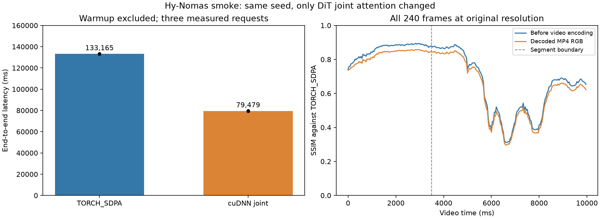
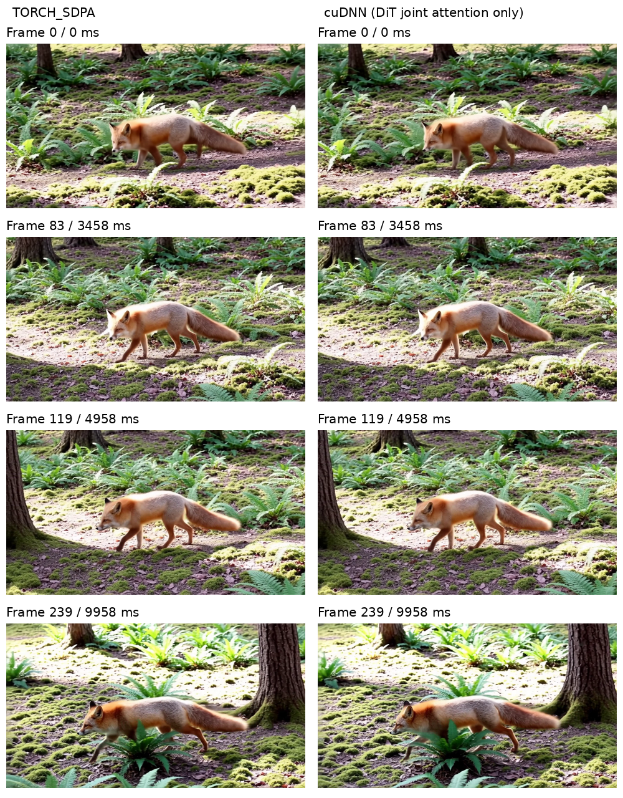

# Hy-Nomas SDPA versus cuDNN video smoke, 2026-10-26

Switching only DiT joint attention to the existing cuDNN backend reduces
median end-to-end latency by **40.3% (1.675x)** on this smoke workload.
The output is not numerically equivalent: all-frame raw RGB SSIM is
**0.712**, and encoded-video RGB SSIM is **0.684** against SDPA.
Both backends reproduce their own video pixels exactly across warmup and
three measured requests. The production backend remains unchanged.



## Performance

All durations are milliseconds. Each cell is the median of three warmed
requests unless specified otherwise.

| Metric | TORCH_SDPA | cuDNN joint attention |
| --- | ---: | ---: |
| End-to-end | 133,164.8 | 79,479.0 |
| First media payload | 51,631.6 | 33,834.8 |
| DiT phases, both segments | 102,194.8 | 48,408.3 |
| Decoder host invocation, both segments | 26,297.4 | 26,409.5 |
| End-to-end sample standard deviation | 80.5 | 77.2 |
| Maximum sampled GPU memory, GiB | 88.250 | 88.250 |

First-media latency falls 34.5%; DiT phase time falls 52.6% (2.11x).
Decoder invocation time is essentially unchanged. There is no measured
peak-memory reduction. GPU memory is device-wide NVML usage sampled during
requests, not allocator-only memory; sampling can miss short peaks.

| Measured request | SDPA end-to-end | cuDNN end-to-end | SDPA first media | cuDNN first media |
| --- | ---: | ---: | ---: | ---: |
| 1 | 133,297.8 | 79,576.9 | 51,756.2 | 33,930.6 |
| 2 | 133,164.8 | 79,424.7 | 51,631.6 | 33,787.6 |
| 3 | 133,152.7 | 79,479.0 | 51,585.6 | 33,834.8 |

The observed median SM clock is 2,422 MHz for SDPA and 2,377 MHz for
cuDNN. Clocks were not locked and run order was not randomized; these
results describe this GPU/session, not every workload or hardware platform.
NVML activity is not occupancy or MFU; neither is newly measured here.

## Numerical and visual differences

The reference is this experiment's TORCH_SDPA output, not ground-truth video.

| Comparison boundary | Frames | Mean SSIM | Global PSNR, dB | MAE, [0, 1] |
| --- | ---: | ---: | ---: | ---: |
| Raw normalized RGB, complete clip | 240 | 0.711931 | 19.263 | 0.065263 |
| Decoded MP4 RGB, complete clip | 240 | 0.683594 | 19.245 | 0.066997 |
| Raw RGB, segment 0 | 84 | 0.859493 | 23.510 | 0.042390 |
| Raw RGB, segment 1 | 156 | 0.632475 | 18.005 | 0.077579 |
| MP4 RGB, segment 0 | 84 | 0.826684 | 23.316 | 0.045047 |
| MP4 RGB, segment 1 | 156 | 0.606545 | 18.015 | 0.078817 |

Segment 0 covers frames 0–83; segment 1 covers frames 84–239.
The lowest encoded-frame SSIM is 0.296 at frame 159 (6,625 ms).
The second segment has greater divergence, but it does not increase
monotonically frame by frame. Latent relative L2 differences are 19.64%
and 45.16% for the two segments. Raw, unclipped model RGB relative L2 over
the full clip is 39.20%. These are differences from SDPA, not percentages
of perceptual quality lost.

The sampled frames retain the fox/forest scene, with visible changes in
pose, fur/lighting and background details. Four stills do not establish
motion quality or temporal consistency. A complete side-by-side preview
and both original MP4s are retained with the local experiment artifacts.
The preview is downscaled; all reported metrics use original resolution.



Differences already exist before encoding. The preceding
[attention diagnosis](hy_nomas_attention_diagnosis.md) found small
same-input attention differences that propagate through the BF16 model.
This new rollout comparison quantifies the final video difference; it does
not prove that cuDNN is perceptually worse or set an acceptable threshold.
A broader prompt/seed set and perceptual review are still needed before
qualifying a backend default change.

## Scope and method

- GPU: one RTX PRO 6000 Blackwell Server Edition, 97,887 MiB,
  driver 580.82.09. PyTorch 2.13.0+cu130, cuDNN 92000 and the same
  vLLM 0.32.0 CI wheel as the attention diagnosis.
- Source head: `3ea7c375f8b1d963ff306c0a1e47fd5aac39149c`.
  Seven relevant remote source/configuration hashes match the checkout;
  the manifest is included with the evidence.
- Model: the same local `tencent/Hy-Nomas-Diffusers` checkpoint as
  [the preceding numerical diagnosis](hy_nomas_attention_diagnosis.md).
- Prompt: `A small red fox walks slowly through a sunlit forest. Ferns and moss cover the ground.`
- Seed 42, 1280 x 704, 240 frames at 24 FPS, eight configured steps,
  CFG 1, BF16, one request at a time. Two processes/stages share GPU 0.
- Baseline deployment: `hy_nomas_two_stage_realtime.yaml`.
  Candidate changes only stage 0 `diffusion_attention_config.per_role`:
  `hy_nomas.joint.backend: CUDNN_ATTN`. The default attention backend
  and decoder remain `TORCH_SDPA` in both cases.
- Run cuDNN first, then SDPA, each in a fresh server process with one
  excluded warmup and three measured requests. No profiler or stack
  capture. Lightweight external hooks record phase timestamps and NVML
  telemetry samples approximately every 100 ms. Large raw tensor saves
  occur only in warmup, never in the three timed requests.
- Client elapsed time runs from before WebSocket connection establishment
  through `session.done` and connection close; first-media time is arrival
  of the first binary payload from that same start point.
  Post-request video hashing is outside those timings. DiT phase time is
  host wall time from chunk preparation to latent handoff after CPU copy;
  decoder invocation time is host wall time and is **not GPU kernel time**.
- Export uses the same streaming H.264 path: `yuv420p`, CRF 18,
  `preset=ultrafast`, `tune=zerolatency`, `threads=0`. Payload fragments
  are retained as one playable MP4 per selected request.

## Comparison contract

Both clips are decoded with PyAV and checked for 1280 x 704, 24 FPS,
240 ordered frames and strictly increasing PTS. FFprobe is not installed;
this is an explicit PyAV validation, not a skipped FFmpeg accuracy gate.
Every frame is compared at its original size without alignment, trimming
or resampling. Preview images/videos are resized only for inspection.

Raw RGB comparisons use the warmup captures before video encoding, with
normalization matching the BF16-preserving shared media path. Measured
request 1 supplies encoded RGB comparisons. Warmup and measured output
pixel hashes are checked within each backend to establish that the raw
capture corresponds to the measured output trajectory.

SSIM uses scikit-image, RGB channels, Gaussian weights, sigma 1.5,
population covariance and data range 1. Reported SSIM is the mean across
all frames. PSNR is computed from the global RGB MSE over the full clip,
with peak value 1; it is not the mean of per-frame PSNR values. MAE also
uses RGB in [0, 1]. Relative L2 divides the difference norm by the SDPA
reference norm. Frame-to-frame deltas are retained in the evidence, but
motion and flicker are confounded in those measurements.

This compares two backend implementations of the same integration. It is
not an independent native-model reference or a calibrated perceptual
quality gate. No acceptance threshold or production default is changed.

## Evidence and reproduction

Machine-readable [summary](hy_nomas_profile_assets/backend_smoke_summary.json)
and [per-frame metrics](hy_nomas_profile_assets/backend_smoke_per_frame.json)
are checked in. Segment-summary minimum-frame indices are relative to that
segment; per-frame rows use absolute clip indices.

The self-contained external harness, exact request, deployment YAMLs,
environment/source manifests, server logs, phase traces, client events,
telemetry and metrics are in `backend-smoke-evidence.tar.gz`:

```text
SHA-256: 61f7f8b83a9e042f6449ff16d81ab25bf93f47a50a5aa7ed449d097d8734b1af
Remote root: /root/autodl-tmp/nomas-backend-smoke
Local root: /tmp/hy-nomas-backend-smoke
```

The archive excludes raw tensors and videos; raw tensors remain remote,
and both original videos plus `comparison-preview.mp4` are copied locally.
The archive manifest records the selected video hashes. Its optional
comparison with older raw diagnostic captures was not bitwise equal, so
those historical tensors are not used as accuracy references here.

Commands, from the remote experiment root after setting the paths in the
retained scripts:

```bash
# Starts each server, waits for readiness, warms up, measures and cleans up.
bash tools/run.sh
# The client command used by run.sh; --repeats 1 selects a single request.
NOMAS_BENCH_ROOT="$PWD/sdpa" /root/autodl-tmp/venv-nomas-review/bin/python \
  tools/benchmark.py --mode baseline --warmup 1 --repeats 3
# Run only after both servers have exited, to avoid CPU contention.
OMP_NUM_THREADS=4 /root/autodl-tmp/venv-nomas-review/bin/python tools/compare.py
```

The server command is preserved in `tools/start-server.sh`: `vllm serve`
through the vLLM Python CLI, `--omni`, the selected `--deploy-config`,
port 8094, offline model loading and external tracing hooks. The concrete
WebSocket `session.start` request is `START` in `tools/benchmark.py`.
Both server processes exited and the GPU compute-process list was empty
after the experiment. No production source or backend default changed.
