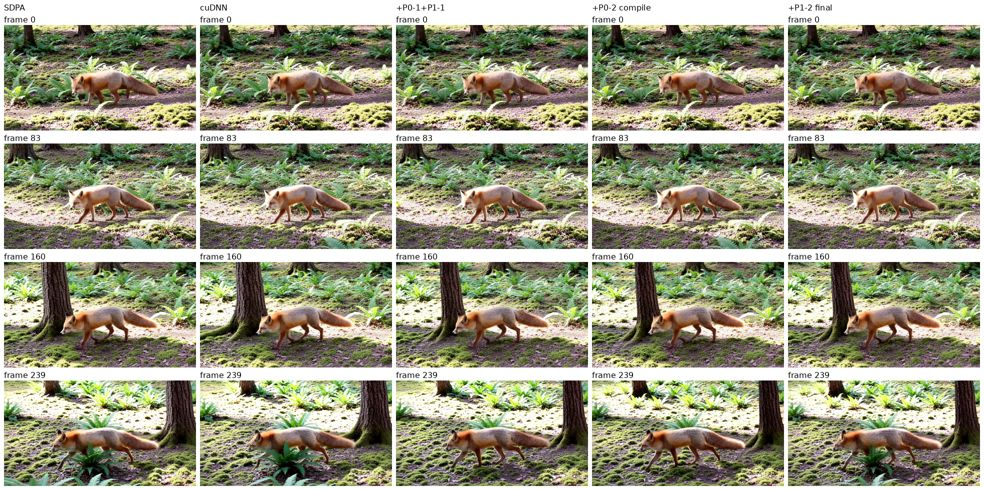

# Hy-Nomas realtime DiT MFU optimization, 2026-10-26

Four changes on top of cuDNN joint attention cut the realtime smoke from
**79,479 ms to 61,404 ms** end to end (1.29x; 2.17x versus TORCH_SDPA) and
raise DiT MFU on valid-token FLOPs from **45.0% to 72.7%**. Peak device
memory falls from 88.25 to 66.12 GiB. Only the final-commit skip is bitwise
exact; the others change BF16 rounding and therefore the sampled trajectory.

## Changes

| Step | Change | Effect |
| --- | --- | --- |
| P0-1 | Skip the Hy-Nomas final-segment KV commit | The last segment's cache-write forward had no reader |
| P1-1 | Run Hy-Nomas joint attention mask-free | Trim right-padded text (25 of 1,280 tokens valid), commit only visible KV, pass no mask |
| P0-2 | Compile the Hy-Nomas realtime DiT stage | `enforce_eager: false` on the DiT stage; regional compile of the 54 blocks |
| P1-2 | Fuse Hy-Nomas QK norm/RoPE (q/k/v merge dropped) | Shared `fused_joint_qkv_norm_rope` op for both streams' Q/K norm, video RoPE and the join |

P1-1 also removes the dense `[heads, Q, K]` Boolean mask that the masked
attention path materialized: 16 x 27,680 x 55,360 bytes is 22.8 GiB, matching
the observed peak-memory drop.

## Workload and method

Same request and hardware as the [profiling report](hy_nomas_profiling.md):
one RTX PRO 6000 Blackwell Server Edition, 1280 x 704, 240 frames, 24 fps,
two 30-latent-frame segments, eight steps, CFG=1, seed 42, fixed fox/forest
prompt, both stages on GPU 0, `hy_nomas_two_stage_realtime.yaml` with
`hy_nomas.joint` on CUDNN_ATTN. PyTorch 2.13.0+cu130, vLLM 0.32.0.

Each configuration starts a fresh server, runs one warmup request and three
measured WebSocket requests with no profiler. The DiT interval spans
`prepare_next_chunk` entry through `producer_emit` exit for both segments, as in
the baseline report. SDPA and cuDNN rows reuse the earlier backend smoke
measured with the same harness.

MFU uses an analytic count of dense linear and QK+AV attention FLOPs (FMA = 2)
against the 467.8 TFLOPS dense BF16 estimate. It reproduces the profiler's
11.883 PFLOP for the unchanged path. *Executed* counts the work each
configuration runs; *useful* counts only valid text tokens and no unread final
commit (10.182 PFLOP DiT). End-to-end MFU adds the unchanged 6.654 PFLOP
decoder. Softmax, normalization, RoPE and pointwise work are excluded.

## Results

Medians of three measured runs; every configuration repeats its decoded-RGB
hash exactly across warmup and measured runs.

| Configuration | E2E (ms) | Stdev (ms) | First media (ms) | DiT (ms) | DiT MFU executed | DiT MFU useful | E2E MFU useful | Peak memory (GiB) |
| --- | ---: | ---: | ---: | ---: | ---: | ---: | ---: | ---: |
| TORCH_SDPA | 133,165 | 81 | 51,632 | 102,195 | 24.9% | 21.3% | 27.0% | 88.25 |
| cuDNN joint attention | 79,479 | 77 | 33,835 | 48,408 | 52.5% | 45.0% | 45.3% | 88.25 |
| + P0-1 final-commit skip | 76,981 | 31 | 34,119 | 45,366 | 52.1% | 48.0% | 46.8% | 88.25 |
| + P1-1 mask-free attention | 69,739 | 141 | 31,313 | 38,723 | 56.2% | 56.2% | 51.6% | 65.58 |
| + P0-2 regional compile | 61,723 | 182 | 26,816 | 30,544 | 71.3% | 71.3% | 58.3% | 68.17 |
| **+ P1-2 fused norm/RoPE** | **61,404** | 54 | **26,778** | **29,930** | **72.7%** | **72.7%** | **58.6%** | **66.12** |

The compiled configurations' first request takes about 93-107 s instead of
85 s because it includes compilation. P1-2's end-to-end change is within
run-to-run spread; its DiT gain is about 0.6 s. A variant that also merged each
stream's q/k/v projections into one GEMM measured 61,560 ms with the fused
norm/RoPE and 61,826 ms without it, so the merge was dropped.

## Output comparison

Decoded raw RGB is compared per frame after normalization to [0, 1]. These
metrics measure divergence from one reference trajectory, not perceptual
quality: a single early-layer attention change already alters the first
prediction by 0.69% ([attention diagnosis](hy_nomas_attention_diagnosis.md)).

| Configuration | Bitwise vs cuDNN | SSIM vs SDPA (seg 0 / seg 1) | PSNR vs SDPA (dB) | SSIM vs cuDNN |
| --- | --- | ---: | ---: | ---: |
| cuDNN joint attention | — | 0.712 (0.860 / 0.632) | 19.26 | — |
| + P0-1 | yes | 0.712 (0.860 / 0.633) | 19.26 | 1.000 |
| + P1-1 | no | 0.689 (0.854 / 0.600) | 18.49 | 0.607 |
| + P0-2 | no | 0.589 (0.677 / 0.542) | 17.15 | 0.549 |
| + P1-2 | no | 0.659 (0.736 / 0.618) | 18.28 | 0.605 |



Reviewed frames show the same scene, sharpness and color without artifacts;
later frames differ in pose and foliage placement. This is not a substitute
for an explicit quality threshold, native-reference comparison, moving-camera
or action prompts, or longer histories, none of which this smoke qualifies.

## Remaining headroom

After these changes, DiT attention dominates its time again. Further gains need
faster attention arithmetic (FP8 cuDNN SDPA or Sage-style quantized attention,
which the mask-free path now permits) or FP8 projections, all of which require
an explicit quality gate.

## Validation and reproduction

The final state passes all 103 Hy-Nomas CPU/CUDA component, pipeline, stage,
decoder, deploy and Qwen prompt tests (one skip); the P0-1 and P1-1 commit
states pass their suites (97 and 101 tests). New cases cover
final-commit skipping, visible-token KV compaction, prompt trimming for right-
versus left-padded text, trimmed-versus-padded transformer equivalence and
fused-versus-eager norm/RoPE.

External harness scripts remain outside the repository, under
`/root/autodl-tmp/nomas-cudnn-opt/tools` on the GPU host:

```bash
# NAME, code root, deploy config; one warmup plus three measured requests
bash tools/run-variant.sh p12f /root/autodl-tmp/nomas-cudnn-p12f \
  /root/autodl-tmp/nomas-cudnn-p12f/vllm_omni/deploy/hy_nomas_two_stage_realtime.yaml
/root/autodl-tmp/venv-nomas-review/bin/python tools/analyze.py p01 p11 p02 p12f
```

`run-variant.sh` reuses the backend smoke's `start-server.sh`, `benchmark.py`
and `sitecustomize.py`. Raw tensors, videos and logs remain under
`/root/autodl-tmp/nomas-cudnn-opt`. Compact metrics:
[dit-mfu-summary.json](hy_nomas_profile_assets/dit-mfu-summary.json).
