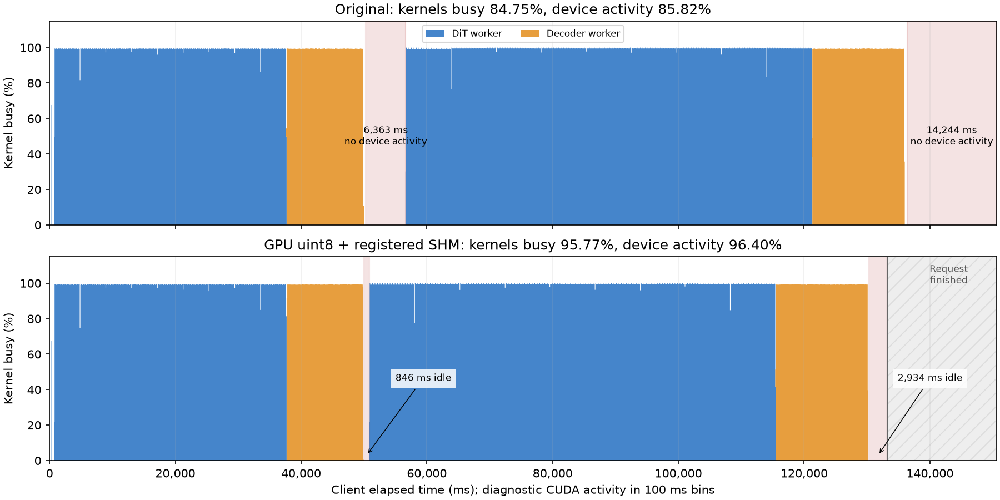

# Hy-Nomas optimization validation, 2026-10-26

The retained change reduces decoded-video delivery overhead by reusing the
existing typed-media, device-reduction and registered-shared-memory paths.
For the fixed two-stage request, median completion improves from **150,648 ms
to 133,214 ms (11.6%)**, with identical decoded RGB bytes. Peak GPU memory does
not show a reliable improvement. DiT and PixelUMM arithmetic are unchanged.

## Retained implementation

`HyNomasDecodePipeline` supplies normalized BCTHW media for `np`/default output.
The common runner owns bounded uint8 conversion and SHM packing, followed by the
common frontend finalizer. The realtime deployment selects `np` on both stages
and enables `enable_device_postprocess` plus `enable_registered_shm` on stage 1.
There is no new conversion kernel, transport protocol or attention backend.
Explicit `pt`/`pil` output retains its previous CPU path; device postprocessing
can be disabled, and frame interpolation retains float media. Buffered empty
segments continue to acknowledge without media.

The observed CUDA uint8 payloads are `[1,84,704,1280,3]` (227,082,240 bytes) and
`[1,156,704,1280,3]` (421,724,160 bytes). The previous BF16-to-float32 SHM path
sent four times these video bytes. The previous report's PIL attribution was
incorrect: its retained Python stacks show NumPy/tensor encoding. That report
has been corrected. The improvement concerns frame conversion and delivery.

## Controlled serving results

The [baseline report](hy_nomas_profiling.md) specifies the frozen weights,
request and FLOP accounting. Candidate production sources are the patch against
`a1f8370898f6cd4abaa157e1ad11f2b4c1e2e53f`, with a source manifest in the evidence
archive. Baseline and candidate use the same physical GPU (UUID equality checked),
driver and inference package versions, in separate sessions:
RTX PRO 6000 Blackwell Server Edition, 97,887 MiB, driver 580.82.09,
PyTorch 2.13.0+cu130, vLLM 0.32.0 at
`5df63a7203cdb9328d824a27b682e77c7b9928be`, Diffusers 0.40.0,
Transformers 5.14.1 and Triton 3.7.1. Both use BF16, TORCH_SDPA, eager execution,
TP=SP=1, concurrency 1, both workers on GPU 0, text-encoder module offload and
segment-boundary allocator cache release. Host quota is 22 CPU equivalents and
110 GiB RAM. Observed SM clock is 2422 MHz in candidate measurements.

The request is 1280 x 704, 240 frames, 24 fps, two 30-latent-frame segments,
eight denoising steps, CFG=1, seed 42, the same fixed fox/forest prompt and no
camera or interactions. One warmup precedes three measurements in the same
server. Profiler capture is disabled; external phase/transport wrappers add no
CUDA synchronization. NVML is sampled every 100 ms. These runs qualify this
workload, not concurrent clients, separate GPUs or longer histories.

| Candidate run | Completion (ms) | First binary media (ms) | Peak device memory (GiB) | Mean NVML activity |
| --- | ---: | ---: | ---: | ---: |
| 1 | 133,153 | 51,681 | 86.23 | 96.84% |
| 2 | 133,545 | 51,665 | 88.25 | 96.51% |
| 3 | 133,214 | 51,791 | 86.23 | 96.73% |

| Three-run statistic | Baseline | Candidate |
| --- | ---: | ---: |
| Median completion (ms) | 150,648 | 133,214 |
| Sample standard deviation (ms) | 571 | 211 |
| Median first binary media (ms) | 58,051 | 51,681 |
| Median peak device memory (GiB) | 86.39 | 86.23 |
| Largest observed device memory (GiB) | 87.18 | 88.25 |

First-media latency improves 11.0%; completion speedup is 1.13x. Memory includes
both worker contexts and allocator occupancy, not only PyTorch allocations.
Candidate peaks occur during second-segment denoising, before its decoder runs.
The worst candidate observation is 1.07 GiB above the old maximum: there is no
qualified VRAM reduction. No overlap or memory-headroom claim follows from the
smaller transfer payload.

Warmup, all three measurements and the CUDA diagnostic produce 240 frames as
84 + 156 media frames with strictly increasing PTS and the baseline RGB SHA-256:
`659b79d4dce02a332667bd8fc04c3f078f3e53aad916c0a2dc1dfc56ad1e2e65`.
This is exact fixed-workload output parity, not universal native-model parity.
Machine-readable results are in
[serving metrics](hy_nomas_profile_assets/optimization-benchmark-summary.json).

## Device activity and remaining bottlenecks

A separate Nsight Systems diagnostic, after warmup, completes in 133,237 ms.
Both workers are captured. CUDA timestamps are aligned using client UTC
nanoseconds minus Nsight's session epoch. This establishes activity unions;
the candidate capture does not provide new operator-to-CPU-range attribution.

| Diagnostic CUDA measure | Baseline | Candidate |
| --- | ---: | ---: |
| Union of kernels (ms) | 127,628 | 127,602 |
| Kernel busy fraction | 84.75% | 95.77% |
| Union of kernels, copies and memset (ms) | 129,231 | 128,435 |
| Device activity fraction | 85.82% | 96.40% |
| Device idle (ms) | 21,360 | 4,802 |
| Largest internal idle window (ms) | 6,363 | 846 |
| Final device-idle tail to client completion (ms) | 14,244 | 2,934 |
| Inter-worker kernel overlap (ms, rounded) | 0 | 0 |



Device idle decreases about 77.5%; kernel time is effectively unchanged.
The one-credit protocol still orders DiT N, decoder N, acknowledgment, DiT N+1.
The producer is idle while the decoder computes; this stage bubble persists,
while the shared GPU is busy. It preserves decode-window interactions for N+1.
Removing credit ordering has not been implemented or qualified by this change.
The baseline identifies DiT masked attention as the dominant compute cost;
PixelUMM attention remains the main decoder cost. Candidate attempts below do
not establish an acceptable faster compute path. At 133,214 ms for 10,000 ms of
video, the deployment still does not generate at playback speed.

Using the unchanged 18.519 PFLOP major-operation estimate and architectural
467.8 dense BF16 TFLOPS denominator from the baseline gives approximately
139.0 achieved TFLOPS and **29.7% end-to-end MFU**, previously 26.3%.
This counts executed overlap/history work. Softmax, normalization, RoPE,
pointwise work and text encoding are excluded. Hardware performance counters
remain denied (`ERR_NVGPUCTRPERM`); neither Tensor Core occupancy nor a measured
roofline claim is available. CUDA busy and NVML activity are not MFU.

## Rejected compute experiments

All prototypes are excluded from the retained production patch. Their scripts,
raw metrics and rejected patches are preserved for follow-up.

| Experiment | Measurement / accuracy evidence | Disposition |
| --- | --- | --- |
| Shared `CUDNN_ATTN` for DiT joint attention | Actual-shape BF16 probe: Q/K=27,680, 55.820 to 19.171 ms; K=55,360, 112.652 to 38.799 ms. Full-weight rollout first prediction relative L2 0.00764 grows to 0.22480; first final latent 0.19637 and RGB 0.24577. | Fails current parity requirement; retain TORCH_SDPA. Random probe closeness does not qualify generation quality. |
| Contiguous Q/K/V before efficient SDPA | Exact probe output. Q/K=27,680: baseline 55.804 ms vs all-contiguous 56.270 ms. K=55,360: 112.609 vs 113.365 ms, copies included. | No measured gain. |
| PixelUMM neighborhood batch size 2 | Full-weight decode 29,181 to 29,795 ms; first-layer calls 660 to 330, raw RGB max absolute difference 0.609375. | Slower and fails parity. Batch sizes 4/8 were not full-weight qualified. |
| Reuse repeated PixelUMM neighborhood gathers | Full-weight raw RGB exact on the 240-frame case and a short moving-camera/action/prompt-update case. Three target repeats: median 29,078 to 29,170 ms. Standalone peak allocated memory remains 18.734 GiB. | No stable target-workload improvement; excluded. Short-case one-shot 16,091 to 15,895 ms is insufficient evidence. |

The cuDNN controls case uses 10+10+1 latent frames, bounded history 1, moving
camera and prompt replacement; its final latent/RGB relative L2 are 0.30003 /
0.39390. The accuracy harness loads released weights strictly and fixes noise.
Its one-shot timings are accuracy diagnostics, not warmed serving benchmarks.
See [attention probe](hy_nomas_profile_assets/optimization-attention-probe.json),
[layout probe](hy_nomas_profile_assets/optimization-attention-layout-probe.json),
[full-weight cuDNN accuracy](hy_nomas_profile_assets/optimization-accuracy-cudnn.json),
[batching](hy_nomas_profile_assets/optimization-decoder-batch-probe.json) and
[gather reuse](hy_nomas_profile_assets/optimization-decoder-reuse-bench.json).

## Reproduction and validation

External scripts remain outside repository examples. The evidence bundle contains
`tools/benchmark.py`, import wrappers, probe scripts, rejected patches, source
manifest, request JSON, telemetry, logs and the CUDA report. Large tensor dumps,
SQLite exports and videos are retained separately on the instance.

```bash
export NOMAS_CODE_ROOT=/root/autodl-tmp/nomas-opt/work-m1
export NOMAS_BENCH_ROOT=/root/autodl-tmp/nomas-opt/bench-m1
bash /root/autodl-tmp/nomas-opt/tools/start-server.sh
# In a second shell, with the same NOMAS_BENCH_ROOT:
/root/autodl-tmp/venv-nomas-review/bin/python \
  /root/autodl-tmp/nomas-opt/tools/benchmark.py \
  --mode baseline --warmup 1 --repeats 1
/root/autodl-tmp/venv-nomas-review/bin/python \
  /root/autodl-tmp/nomas-opt/tools/benchmark.py \
  --mode baseline --warmup 0 --repeats 2 --offset 1
```

The split command sequence extends one warmed server; `--offset 1` preserves
previous results and appends telemetry. The first warmup completes in 146,183 ms
with first media at 64,518 ms. Source paths `work` and `work-m1` have identical
production files; no rejected decoder or attention change is active in serving.

The two-process WebSocket service passes three sequential control cases:
reject unsupported playback pacing; cancel during decoder segment 0; immediately
recover and submit changed prompt plus camera during recovery segment 0 decode.
Controls arrive 39 ms into an 11,899 ms decoder window. Segment 1 is prepared
1,579 ms after decoder exit with the replacement prompt, and both interaction
IDs first appear on segment 1. Recovery emits 84 + 156 frames with strict PTS.
Cancellation returns `stopped=true`, with no media chunks, in 3.3 ms after stop.

The final affected suite passes **185 tests**, including six CUDA component
cases, plus model, deployment, media reduction/finalization, SHM/IPC, stage
parameters, segment handoff and streaming video tests. The added eight model
cases exercise full-request/incremental decoding, implicit/explicit `np`, and
device postprocessing enabled/disabled through the real shared transport helpers.
No validation server or CUDA worker remains after the suite.

The final diff-scoped pre-commit gates pass, including mypy, SPDX, forbidden
imports, the CUDA-API ratchet, test marks and Markdown lint. Source manifests
match all four production/config/test files in both remote snapshots. No
model-specific Python example, custom backend or generic protocol change is
introduced.

Evidence archive on the instance: `/root/autodl-tmp/nomas-opt-evidence.tar.gz`;
local copy: `/tmp/hy-nomas-opt-results/nomas-opt-evidence.tar.gz`.
SHA-256: `847f229c48079497add63930c8bb58cd890a75c20d0e2b0e3f1d861660c8bfb2`.
Raw tensors, videos and SQLite files remain under `/root/autodl-tmp/nomas-opt`;
the small metrics and activity figure above are committed with this report.

The subsequent [attention numerical diagnosis](hy_nomas_attention_diagnosis.md)
locates the first divergence and compares captured inputs to FP64. It finds
comparable local error for both backends and strong downstream sensitivity;
the historical parity failure does not by itself prove cuDNN is less accurate.

The later [DiT MFU optimization](hy_nomas_dit_mfu.md) adopts cuDNN joint
attention for the realtime deployment and adds mask-free attention, regional
compile and fused Q/K/V norm/RoPE, with measured latency, MFU and output drift.
