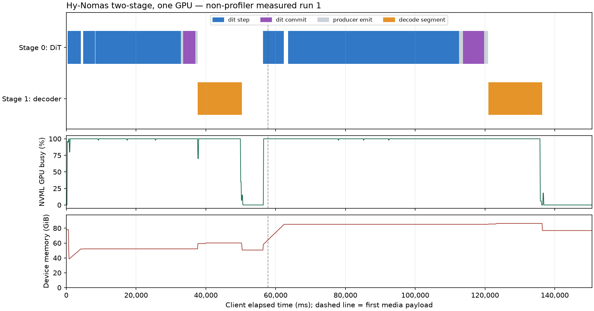
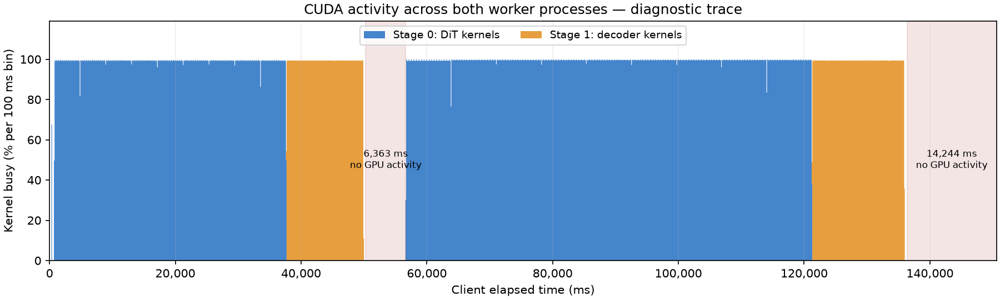

# Hy-Nomas two-stage profiling, 2026-10-26

The validated interaction-boundary fix is commit
`f3e0f9d78263965ec83cc1de82a6490bcc5e3d29`, rebased onto main
`36027f8f936dd456de7dfc220fd871dfe826106d`. It was pushed to the fork's
`feat/nomas_multi_stage` branch before profiling. Production Python and deployment
files on the GPU instance match that commit; only the integration Markdown was
older in the remote snapshot.

For this single-GPU workload, DiT attention is the largest compute bottleneck.
There are also substantial device-idle intervals in the decoded-media delivery
path. Separate stages do not currently overlap their GPU computation. This
report establishes a baseline, not a speedup against single-stage execution.

## Workload and environment

| Item | Value |
| --- | --- |
| GPU | One NVIDIA RTX PRO 6000 Blackwell Server Edition, 97,887 MiB |
| Driver / CUDA / power limit | 580.82.09 / CUDA 13.0 / 600 W |
| Software | PyTorch 2.13.0+cu130, vLLM 0.32.0, Diffusers 0.40.0, Transformers 5.14.1, Triton 3.7.1 |
| vLLM wheel revision | `5df63a7203cdb9328d824a27b682e77c7b9928be`, matching repository CI |
| Model | Local `tencent/Hy-Nomas-Diffusers`, strict released-weight loader |
| Deployment | `hy_nomas_two_stage_realtime.yaml`, both workers on GPU 0 |
| Execution | BF16, TORCH_SDPA, eager, TP=1, SP=1, concurrency=1 |
| Memory policies | Module offload for text encoder; cache release at segment boundaries |
| Request | 1280 × 704, 240 frames, 24 fps, two 30-latent-frame segments |
| Sampling | Eight denoising steps per segment, guidance=1, seed=42 |
| Conditioning | Fixed fox/forest prompt; no camera input or interaction events |
| Host allocation | 22 CPU-equivalents of quota, 208 affinity-visible CPUs, 110 GiB RAM limit |

The decoder is the PixelUMM transformer, rather than a convolutional VAE.
The camera-attention branch is inactive in this workload. Results do not qualify
moving-camera performance, concurrent clients, separate GPUs, or longer histories.

## Non-profiler baseline

One warmup request preceded three measured requests in the same server. No
PyTorch profiler, stack capture, NVTX ranges, or FLOP hooks ran during these
measurements. External wrappers recorded host phase boundaries without forcing
CUDA synchronization; NVML was sampled every 100 ms. The configured CUDA profiler
was not started. These runs are authoritative for latency and memory.

| Run | Client completion (ms) | First binary media (ms) | Peak device memory (GiB) | Mean NVML GPU activity |
| --- | ---: | ---: | ---: | ---: |
| 1 | 150,648 | 57,842 | 86.39 | 85.63% |
| 2 | 151,256 | 58,051 | 87.18 | 85.16% |
| 3 | 150,113 | 58,211 | 86.39 | 85.88% |
| Median | **150,648** | **58,051** | **86.39** | **85.63%** |

Completion-time sample standard deviation is 571 ms. The DiT's complete active
intervals total 102,184 ms median; decoding totals 28,155 ms. DiT interval N spans
`prepare_next_chunk` entry through `producer_emit` exit, including conditioning,
scheduler work, KV commit and latent handoff, but excluding its acknowledgment
wait. The two DiT intervals individually take approximately 37,614 and 64,570 ms.
The remaining approximately 20,310 ms of client completion time is outside those
complete stage intervals. Component medians are not an exact additive run trace.

All measured and diagnostic videos decode to 240 frames at 1280 × 704, with
strictly increasing PTS and media segments of 84 + 156 frames. Their decoded-RGB
SHA-256 is identical:
`659b79d4dce02a332667bd8fc04c3f078f3e53aad916c0a2dc1dfc56ad1e2e65`.
This checks repeatability for the fixed request, not full native-model parity.



The memory figures include both CUDA processes, contexts and allocator occupancy;
they are not PyTorch peak allocated-memory counters. The largest observation
leaves approximately 8.4 GiB of the visible device capacity. Overlapping more live
work or removing cache release therefore needs a separate memory qualification.

## Device timeline and bubbles

Nsight Systems 2025.3.1 captured CUDA, NVTX and OS-runtime activity from both
worker processes, excluding initialization and warmup. The diagnostic request
completed in 150,591 ms, within baseline variation. Torch operator/shape profiling
and host-stack profiling were separate requests.

| CUDA activity measure | Time (ms) | Fraction of client request |
| --- | ---: | ---: |
| Union of kernels across both workers | 127,628 | 84.75% |
| Union of kernels, copies and memset | 129,231 | 85.82% |
| No kernel, copy or memset active | 21,360 | 14.18% |
| Largest internal idle interval, after decoder segment 0 | 6,363 | 4.23% |
| Final idle tail, last GPU work to client completion | 14,244 | 9.46% |

Within the first-to-last device-activity window, activity reaches 94.80%.
The two large empty intervals account for approximately 96.5% of all device idle
time. Kernel overlap between the two workers is **0 ms** in this trace.



The one-credit protocol executes DiT N, decoder N, acknowledgment, then DiT N+1.
An idle producer during decoder computation is a stage bubble, while the GPU
remains busy. On one GPU, simply removing this ordering does not add compute
capacity. It also changes the point at which decode-time interactions take effect
and may increase peak memory. Moving acknowledgment after model decode but before
expensive media transport is a candidate only if control delivery, output order,
bounded buffering and cancellation remain correct.

The first media encoder invocation already overlaps the next DiT interval in
the trace. Its whole duration cannot be subtracted from request latency.
Playback pacing remains unsupported for this two-stage topology.

## DiT and decoder hotspots

CUDA kernels are attributed through their launch correlation to the innermost
CPU NVTX range. Using only execution-time overlap would incorrectly charge
asynchronous denoising work to `post_decode` and undercount KV commits.

| Kernel family | DiT, 16 denoising forwards (ms) | Two KV-commit forwards (ms) | PixelUMM, 11 windows (ms) |
| --- | ---: | ---: | ---: |
| Attention | 72,618 | 9,074 | 4,346 |
| GEMM | 6,055 | 757 | 12,730 |
| Copy / concatenation / layout | 4,433 | 554 | 3,211 |
| Norm / reduction | 855 | 107 | 586 |
| Other kernels | 5,707 | 713 | 5,796 |
| Total | **89,668** | **11,205** | **26,669** |

DiT attention consumes approximately **81%** of its model kernel time. Its main
kernel is PyTorch memory-efficient SDPA's
`fmha_cutlassF_bf16_aligned_64x128_rf_sm80`. Main attention has Q length 27,680;
K length grows from 27,680 to 55,360 with the previous segment's KV, with
16 heads of dimension 128. Targeted shape traces show approximately 3,004 ms of
attention per first-segment forward versus 6,077 ms with history. This explains
the much longer second DiT interval. The mask displayed as quadratic by the
operator trace does not establish a physically materialized quadratic allocation.

PixelUMM spends approximately **47.7%** of kernel time in GEMM, **16.3%** in
attention and **12.0%** in copy/layout kernels. Its 11 overlapping windows each
contain 35,200 tokens and 36 blocks. The run makes **23,760** local attention
calls, generally Q=640, K=5,760 with 32 query heads and eight KV heads, dimension
128; edge neighborhoods have smaller shapes. The decoder launches 107,206 model
kernels. Grouping compatible neighborhoods and reusing gather/layout buffers is
more targeted than replacing every decoder operator.

### Decoded-media host path

An additional, separately instrumented request timed the production IPC and
serialization functions. This was a first request in a new worker and is
diagnostic, not a baseline or an optimization A/B result.

| Host operation | First 84-frame output (ms) | Final 156-frame output (ms) |
| --- | ---: | ---: |
| Worker SHM packing | 1,008 | 1,665 |
| Engine SHM unpacking | 766 | 1,336 |
| Video postprocess | 772 | 1,373 |
| Stage output MsgPack encoding | 1,742 | 3,289 |
| Frontend MsgPack decoding | 527 | 914 |
| fMP4 media encoding | 956 | 1,429 |

SHM array writes/reads are nested in packing/unpacking and must not be added
again. The legacy path transports a large floating-point RGB tensor to the
engine, creates PIL frames, then serializes their uncompressed pixel bytes to
the frontend. The measurements identify substantial copying and serialization
cost beyond H.264 encoding. They do not assign every remaining socket, queue,
allocation, WebSocket-send or scheduling interval to a specific function.

## Approximate MFU

FLOPs come from actual module input shapes during a separate diagnostic request:
`2*M*N*K` for linear layers, the corresponding dense convolution formula, and
`4*B*Nq*Nk*Hq*D` for attention QK+AV. FMA counts as two FLOPs. Counts include
16 denoising forwards, two KV commits, padded/history positions and all 11
decoder overlap windows. They exclude text encoding, softmax, normalization,
RoPE and pointwise work. This is a major-operation estimate of executed inference
work, rather than FLOPs for unique output frames. It avoids applying
`2*parameter_count*tokens` to modulation matrices evaluated on one timestep row.

The denominator is approximately **468 TFLOPS dense BF16 with FP32 accumulation**.
This is an architectural estimate: NVIDIA's workstation whitepaper specifies
503.8 dense / 1007.6 sparse TFLOPS at 2617 MHz; scaling the same GB202 configuration
to this instance's reported 2430 MHz maximum gives 467.8 TFLOPS. It is not an
independently published exact server-board dense specification.
See the [NVIDIA RTX PRO Blackwell architecture whitepaper](https://www.nvidia.com/content/dam/en-zz/Solutions/design-visualization/quadro-product-literature/pdf/NVIDIA-RTX-Blackwell-PRO-GPU-Architecture-v1_1.pdf)
and [server-board specifications](https://www.nvidia.com/en-us/data-center/rtx-pro-6000-blackwell-server-edition/).

| Scope | Estimated FLOPs | Time basis (ms) | Achieved TFLOPS | Approximate MFU |
| --- | ---: | ---: | ---: | ---: |
| Complete DiT active intervals, baseline median | 11.865 PFLOP | 102,184 | 116.1 | **24.8%** |
| Complete decoder invocations, baseline median | 6.654 PFLOP | 28,155 | 236.3 | **50.5%** |
| End-to-end, baseline median | 18.519 PFLOP | 150,648 | 122.9 | **26.3%** |
| DiT denoising kernels only, diagnostic | 10.547 PFLOP | 89,668 | 117.6 | 25.1% |
| PixelUMM kernels only, diagnostic | 6.654 PFLOP | 26,669 | 249.5 | 53.3% |

Using a rounded 500 TFLOPS dense denominator instead gives 24.6% end-to-end MFU.
BF16 GEMM calibration, run after model processes released the GPU, achieves
415.2 TFLOPS at 8192-square and 413.8 TFLOPS at 16384-square. Representative
DiT and decoder projection shapes achieve 387.1 and 404.1 TFLOPS. These are
calibration measurements, not alternate theoretical peaks.

The instance denies GPU performance-counter access (`ERR_NVGPUCTRPERM`), so SM
occupancy and Tensor Core utilization were not measured. NVML GPU activity and
CUDA busy time measure whether work exists, not how efficiently Tensor Cores
execute it. These results do not by themselves prove a compute- or bandwidth
roofline classification. Unrelated-process Python stack attachment was also
denied; targeted in-process CPU-stack traces and explicit function timing were
used instead.

## Next optimization candidates

| Priority / milestone | Candidate and evidence | Benefit to test | Implementation / validation | Quality risk |
| --- | --- | --- | --- | --- |
| P0 / M1: host/media | Reduce repeated float-RGB, PIL and MsgPack copies; two long empty intervals and measured IPC costs | Recover part of the approximately 20,607 ms in the two largest idle intervals; this is a ceiling, not a promised saving | Reuse typed media/SHM transport and supported planar conversion; benchmark without profiler, retain exact frame/hash/PTS checks and decode-time interaction/cancel regressions | Low if conversion and lifetime contracts remain identical |
| P1 / M2: attention | Qualify a faster masked-attention path through the existing shared dispatcher; DiT attention is 81% of its kernel time | A hypothetical 2× improvement of this family saves approximately 40,846 ms before other effects; no such speedup is demonstrated | Reuse shared HY1.5/backend infrastructure; preserve full history, action masks and padding semantics; compare full-weight predictions, latents, RGB and temporal quality | Medium/high: previous token removal changed BF16 results; merely selecting FlashAttention is not qualified |
| P1 / M3: decoder | Batch compatible local neighborhoods and reduce repeated gather/cat/RoPE/norm layouts; 23,760 attention calls and 3,211 ms of layout kernels | Reduce launches and memory traffic while retaining GQA and overlap windows | Reuse existing attention/norm helpers; fixed-seed raw RGB checks including window edges, three-run latency/memory A/B | Medium: batching/fusion can change reduction order |
| P1 / M4: stage protocol | Separate decode-complete credit from expensive media delivery, with bounded output ownership | Reduce producer waiting in the internal idle interval; single-GPU compute overlap is not an assumed benefit | Preserve next-segment interaction timing, one-credit/bounded buffering, output order, abort/recovery; remeasure peak memory | Medium: lifecycle and interaction semantics |
| P2: memory/precision | Quantization, shorter KV history or deeper concurrent stage overlap | Fit smaller cards or reduce compute only after a separate quality/memory study | Explicit quality acceptance and prompt/camera/long-history validation; existing 8.4 GiB headroom is insufficient evidence for unrestricted overlap | High; not enabled or qualified by this report |

## Commands and retained evidence

The remote code root is `/root/autodl-tmp/hy-nomas-review-work`; the isolated
runtime is `/root/autodl-tmp/venv-nomas-review`. The deployment copy adds
`profiler_config: {profiler: cuda}` to each stage for endpoint-controlled Nsight
capture. That profiler is inactive during baseline. External import wrappers
change instrumentation only, not production model arithmetic or scheduling.

Actual server command, executed by `hy-nomas-profile-tools/start-server.sh`:

```bash
cd /root/autodl-tmp/hy-nomas-review-work
export PYTHONPATH=.:/root/autodl-tmp/hy-nomas-profile-tools:/root/autodl-tmp/hy-nomas-test-deps
export PATH=/root/autodl-tmp/venv-nomas-review/bin:$PATH
export HF_HUB_OFFLINE=1
export NOMAS_PROFILE_ENABLE=1
export NOMAS_PROFILE_ROOT=/root/autodl-tmp/nomas-profile
python -m vllm.entrypoints.cli.main serve \
  /root/autodl-tmp/models/tencent/Hy-Nomas-Diffusers --omni \
  --deploy-config /root/autodl-tmp/nomas-profile/deploy.yaml --port 8094
```

The exact request is in the retained `benchmark.py`: connect to
`ws://127.0.0.1:8094/v1/realtime/video`, send this message, ping periodically,
collect binary media through `session.done`, then decode and validate the MP4:

```json
{"type":"session.start","model":"/root/autodl-tmp/models/tencent/Hy-Nomas-Diffusers","prompt":"A small red fox walks slowly through a sunlit forest. Ferns and moss cover the ground.","width":1280,"height":704,"num_frames":240,"fps":24,"num_inference_steps":8,"guidance_scale":1.0,"seed":42}
```

Single request and authoritative repeated benchmark:

```bash
python /root/autodl-tmp/hy-nomas-profile-tools/benchmark.py --mode baseline --warmup 0 --repeats 1
python /root/autodl-tmp/hy-nomas-profile-tools/benchmark.py --mode baseline --warmup 1 --repeats 3
```

Separate diagnostics, with Nsight wrapping a fresh server for its request:

```bash
python /root/autodl-tmp/hy-nomas-profile-tools/benchmark.py --mode torch --warmup 0 --repeats 1
nsys profile --trace=cuda,nvtx,osrt --sample=none --cpuctxsw=none \
  --capture-range=cudaProfilerApi --capture-range-end=stop \
  --trace-fork-before-exec=true --cuda-memory-usage=true --force-overwrite=true \
  --output=/root/autodl-tmp/nomas-profile/pipeline \
  bash /root/autodl-tmp/hy-nomas-profile-tools/start-server.sh
python /root/autodl-tmp/hy-nomas-profile-tools/benchmark.py --mode nsys --warmup 1 --repeats 1 --profile-api
python /root/autodl-tmp/hy-nomas-profile-tools/benchmark.py --mode host --warmup 0 --repeats 1
python /root/autodl-tmp/hy-nomas-profile-tools/benchmark.py --mode ipc --warmup 0 --repeats 1
```

Use the isolated runtime's Python for these client commands. `torch` ran on the
already warmed baseline server; `host` ran after Nsight collection stopped;
`ipc` used a fresh plain server. Preserve wrapper versions when replaying:
`sitecustomize-baseline-v1.py` for baseline/Torch, `sitecustomize-nsys-v2.py` for
Nsight/host, and final `sitecustomize.py` for IPC. Copy the selected version to
the import directory as `sitecustomize.py` before starting its server.

Torch shape collection omits stacks; host collection enables stacks and omits
shapes. Torch and host diagnostic requests take 172,979 and 170,047 ms, and
must not replace the baseline. Torch traces include profiler `Command Buffer
Full` overhead; the kernel-family table above uses Nsight instead. The IPC
diagnostic takes 164,653 ms including cold-worker initialization effects.

Raw evidence and executable probes are retained in
`/root/autodl-tmp/nomas-profile-evidence.tar.gz`, SHA-256
`75c2ea6e1d64bf81c6f7765ad518e49bad5afe7b92d4490222699741ae55f4d4`.
It contains server/client logs, the deployment, all probe/analyzer scripts,
baseline telemetry and phase ranges, shape/FLOP records, Torch traces, host
traces, `pipeline.nsys-rep`, runtime/source manifests, and summaries. SQLite is
reproducible with `nsys export --type sqlite`; videos are retained separately
as `nomas-profile/measured-1.mp4`, `torch-1.mp4` and `nsys-1.mp4`.
Compact results are checked in as [metrics.json](hy_nomas_profile_assets/metrics.json).
All model-serving processes started for this profiling were stopped, and the
GPU process list was empty after collection. The instance itself remains on.
